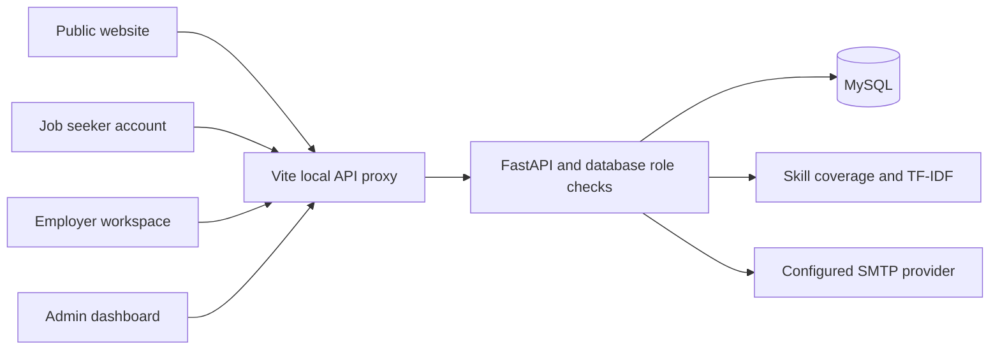

# Khmer Job & Skills Matcher

A Cambodian recruitment portal with a React/Vite frontend, FastAPI API, and MySQL storage. The public website, job-seeker accounts, employer workspace, and administrator dashboard share one authentication system. Fictional sample employers and vacancies are clearly labeled.

## Open the running application

| Area | Address | Access |
|---|---|---|
| Website and jobs | http://localhost:5173 | Public |
| Registration / login | http://localhost:5173/register ? http://localhost:5173/login | Public |
| Job-seeker account | http://localhost:5173/account | Job seeker |
| Resume versions | http://localhost:5173/account/resumes | Job seeker |
| Recommendations | http://localhost:5173/account/recommendations | Job seeker |
| Applications / updates | `/account/applications` ? `/account/notifications` | Job seeker |
| Company directory | http://localhost:5173/companies | Public |
| Employer onboarding | http://localhost:5173/employer-register | Public; publishing needs approval |
| Employer jobs | http://localhost:5173/employer/jobs | Employer |
| Applicants / company / analytics | `/employer/applications` ? `/employer/company` ? `/employer/analytics` | Employer |
| Administrator dashboard | http://localhost:5173/dashboard | Admin only |
| API documentation | http://localhost:5173/docs | Documentation; endpoints enforce roles |
| Smart Home design concept | http://localhost:5173/smart-home | Admin only; illustrative data |

Public registration creates the existing `student` database role, displayed as a job-seeker account. Normal users return to jobs or a requested job/account page after login. Admins enter `/dashboard`; employers enter their workspace. Roles are read from the database. There is no public admin registration.

## Interface languages

Use the shared language selector to switch between **English**, **Khmer**, and **Simplified Chinese** on the website, sign-in pages, and dashboards. The choice is saved in the browser. Interface text, form labels, standard categories/statuses, dates, and salary labels are localized. Employer/user content stays in its original language; no external translation service receives private data. See [language setup and maintenance](docs/LANGUAGES.md).

## What is implemented

- Responsive purple recruitment homepage, original hero artwork, carousel, search, location/type/function filters, employer directory/profiles, career guides, and pagination.
- Real account registration/login/logout, Argon2 password hashing, JWT validation, current-role enforcement, revocable sessions, and login/registration throttling.
- Job-seeker profile, skills, experience/preferences, profile completion, saved jobs, applications, status tracking, and in-app notifications.
- Private resume versions, owner download/delete, optional resume attachment at application time, employer access limited to their own applicants, and reviewed skill extraction.
- Explainable ranked recommendations combining skill coverage, character TF-IDF similarity, and location/category preferences.
- Employer registration pending approval, company profile editing, job creation/editing/closing/reopening, salary and experience fields, applicant review, allowed status transitions, private attached-resume download, and analytics.
- Admin statistics, user activation/deactivation, employer approvals, job moderation, searchable paginated tables, skill creation, and CSV summary export.
- Five connected authentication screens with field validation, password visibility/strength, OTP controls, loading/errors, and disabled social-provider buttons. Real SMTP recovery endpoints are implemented; delivery is intentionally not configured yet.

**Not a claim of 100% production readiness:** some dependency-backed paths and browser checks cannot run in this environment. See [release checks](docs/RELEASE_CHECKS.md) for the remaining verified limitations. Earlier implementation notes are preserved in [implementation history](docs/IMPLEMENTATION_HISTORY.md).

## Local setup (Windows PowerShell)

The current checkout already has private `.env` files configured for XAMPP database `khmer_job_matcher`. Preserve them. Never drop/reset an existing database or overwrite its credentials.

1. Start **MySQL** in XAMPP.
2. Use Python 3.11+ and Node.js with npm. From the project root:

```powershell
cd backend
# Only create a venv if it does not already exist:
if (!(Test-Path venv)) { python -m venv venv }
.\venv\Scripts\python.exe -m pip install -r requirements.txt
# Only copy the example when .env is missing:
if (!(Test-Path .env)) { Copy-Item .env.example .env }
```

For a fresh setup, configure `DATABASE_URL`, `FRONTEND_ORIGIN=http://localhost:5173`, and a randomly generated `JWT_SECRET` of at least 32 bytes in `backend/.env`. Keep it private. The example uses a dedicated MySQL application user; an existing local XAMPP installation can use its configured account. Do not deploy using a local root/no-password account.

```powershell
.\venv\Scripts\python.exe -m alembic upgrade head
.\venv\Scripts\python.exe -m app.seed
.\venv\Scripts\python.exe -m uvicorn app.main:app --host 127.0.0.1 --port 8000
```

Migrations are additive through `0005`. They preserve existing rows. The seed adds four fictional jobs and nine skills, skips existing demo keys, and creates no login accounts.

In another terminal:

```powershell
cd D:\Project_Python_y4s2\khmer-job-matcher\frontend
npm install
if (!(Test-Path .env)) { Copy-Item .env.example .env }
npm run dev
```

`frontend/.env` uses `VITE_API_BASE_URL=/`. Vite proxies `/api`, `/docs`, and `/openapi.json` to FastAPI on port 8000. Restart Vite after changing configuration or installing dependencies. Use `npm install` to refresh the lockfile before attempting `npm ci`.

After installation/migrations, the convenience helper can start missing servers and check actual database reads:

```powershell
.\scripts\Start-Local.ps1
```

It stores logs in ignored `.local-run/`, does not install/migrate/reset anything, and never changes Windows security settings. Its syntax is checked; its process-launch branch has not been exercised here. If scripts are blocked, use the separate commands above.

### Create privileged accounts

From `backend`, these commands prompt privately for a password and refuse an existing email:

```powershell
.\venv\Scripts\python.exe -m app.create_user --role admin --email admin@example.com
.\venv\Scripts\python.exe -m app.create_user --role employer --email employer@example.com --company "Your company"
```

Use your chosen email. Employers can also register publicly and wait for administrator approval. Suspending a company removes its jobs from public search and recommendations. Disabling an employer account also suspends publishing.

### Forgot the local administrator password?

If you own this local installation and cannot sign in, reset an existing account from `backend` without needing SMTP:

```powershell
.\venv\Scripts\python.exe -m app.reset_password --email admin@example.com
```

Enter a new password of 12-128 characters twice when prompted. Password input is hidden. The command preserves the user's role, profile, and applications and revokes old sessions and recovery codes. It never creates or promotes users and never accepts a password as a command-line argument. Then sign in at `http://localhost:5173/login`. This operator command is not a public password-reset API.

## Password recovery email setup

You requested completion of the code without configuring a provider. Real recovery therefore stays disabled until these values are supplied privately in `backend/.env`:

```dotenv
SMTP_HOST=your-provider-host
SMTP_PORT=587
SMTP_USER=your-provider-user
SMTP_PASSWORD=your-private-provider-password
SMTP_FROM=your-verified-sender@example.com
SMTP_STARTTLS=true
SMTP_SSL=false
```

Use the settings required by your provider. For implicit TLS on port 465, set `SMTP_SSL=true` and `SMTP_STARTTLS=false`. Never paste the provider password into chat or commit `.env`.

Restart the API, then `/forgot-password` uses the real recovery service. Responses do not reveal whether an account exists. Codes expire after ten minutes, allow limited attempts, and are stored as keyed hashes. Verification returns a short-lived random reset token held only in browser memory; the database stores its hash. Reset tokens are single-use, and changing a password revokes existing access tokens. SMTP delivery runs after the HTTP response and errors are logged without code/email content.

`/forgot-password?demo=1` remains a separately labeled frontend preview with public code `123456`. It sends no email and changes no password. Google and Facebook authorization-code integration is implemented; buttons stay disabled until your provider credentials are configured. See [social sign-in setup](docs/SOCIAL_LOGIN.md). Apple remains unavailable.

## Google and Facebook sign-in

Google and Facebook sign-in are implemented with server-side code exchange, browser-bound single-use state, account connection in Settings, and normal role-based routing. New social accounts are job seekers. Existing email matches require deliberate authenticated linking; identities cannot silently take over existing accounts.

Add your provider app credentials privately to `backend/.env`, register the exact callback `http://localhost:5173/oauth/callback`, and restart FastAPI. Do not put secrets in frontend code. Both providers are currently unconfigured; real provider sign-in has not been exercised. Follow [the complete social sign-in setup](docs/SOCIAL_LOGIN.md).

## Resume handling

- PDF and UTF-8 `.txt`, maximum 5 MB, ten retained versions per account.
- Text uploads work with the current environment. PDFs need **PyMuPDF**, declared in requirements but not installed here due blocked package access. Unsupported PDF parsing returns an explicit error.
- PDF content is parsed, not trusted from its extension. Encrypted/overlong PDFs are rejected; textless scanned PDFs report that OCR is unsupported.
- Files are private database records, not publicly hosted URLs. Small chunks support XAMPP's default 1 MB packet limit without global server changes. Existing single-blob records remain readable.
- Applications attach the latest immutable version when the applicant chooses to include it. Another upload does not replace an existing application's attachment. Deleting a version removes access from previous applications.
- Detected skills are suggestions. They are added to the profile only after the user reviews them and explicitly saves.
- Retention lasts until the owner deletes the file. No resume text is written to logs. Backups can retain deleted data until the operator expires those backups.

## Machine learning recommendations

The job matcher now trains and saves a TF-IDF catalog model. Only approved, open job listings determine its learned vocabulary and IDF weights; student profiles are transformed against those fixed weights. Changed job content refreshes the model automatically. Artifacts use signed JSON and contain no candidate profile or resume text.

Score = **65% required-skill coverage + 25% TF-IDF cosine similarity + 5% preferred location + 5% preferred category**. Scores estimate compatibility, not hiring probability. `/account/recommendations` shows matched/missing skills, weighted points, filters, pagination, and actual model metadata. Administrators can inspect and retrain the model from `/dashboard`.

The current local model uses the built-in TF-IDF engine: four sample jobs, 990 learned character features. Package downloads are blocked here, so the implemented scikit-learn training branch and its optional parity test could not execute. Install dependencies in a network-enabled terminal to enable it:

```powershell
cd backend
.\venv\Scripts\python.exe -m pip install -r requirements.txt
.\venv\Scripts\python.exe -m app.ml.train --engine sklearn
# Restart FastAPI after installation.
```

See [the machine learning guide](docs/MACHINE_LEARNING.md) for training, configuration, architecture, API endpoints, evaluation, and limitations. A synthetic two-profile evaluation ran successfully; it is a sanity check, not a real-world accuracy benchmark.

## Tests

```powershell
# backend
.\venv\Scripts\python.exe -m pytest -q

# frontend
npm test
npm run test:routes
npm run test:ui
npm run lint
npm run build
```

The backend uses isolated SQLite fixtures, never your XAMPP data. Tests cover authentication/roles, ownership, migration up/down, applications, company approval, resumes, matching, notification isolation, SMTP recovery with a captured test mailer, reset-token replay, and throttling.

### Browser tests and CI

Browser tests use separate ports **5175/8011** and an isolated SQLite database under ignored `.local-run/e2e/`. They refuse to reuse your running MySQL-backed servers. The configuration follows [Playwright's web-server workflow](https://playwright.dev/docs/test-webserver).

```powershell
cd frontend
npm install
npx playwright install chromium
$env:E2E_PYTHON = (Resolve-Path ..\backend\venv\Scripts\python.exe).Path
npm run test:e2e
```

These checks cover mobile overflow/menu, login guards, registration, private resume upload, applying/tracking, and admin routing. CI configuration is in `.github/workflows/checks.yml`. It runs backend tests, UI tests, build/lint, and isolated browser tests when the repository is pushed to GitHub. Neither browser tests nor CI were executed in this session; no screenshots or results are fabricated.

## Structure

```text
frontend/
  src/components/       reusable job, company, auth, and layout components
  src/pages/            public, account, employer, and admin pages
  src/context/          shared authentication/recovery state
  src/hooks/            API resource and form hooks
  src/services/         API client, matching display, validation, downloads
  src/smart-home/       separate illustrative dashboard design
  e2e/                  isolated browser checks
  tests/                unit, UI, and route-render checks
backend/
  app/core/             settings, JWT, authorization, throttling
  app/models/           SQLAlchemy tables and relationships
  app/routers/          auth, jobs, applications, companies, resumes, management
  app/ml/               explainable TF-IDF baseline
  app/services/         SMTP delivery
  alembic/versions/     incremental migrations
  tests/                isolated API/workflow/migration checks
```

## Architecture



Core entities are `users`, `student_profiles`, `skills`, `student_skills`, `employers`, `jobs`, `job_skills`, `applications`, `saved_jobs`, `resumes`, `resume_chunks`, `password_resets`, `rate_limits`, and `notifications`. Legacy role/table names are retained for migration compatibility. A resume belongs to one user; an application references a job and an optional resume version; employer access is derived from ownership of that job.

## Delivery limits

See [release checks](docs/RELEASE_CHECKS.md). English/Khmer navigation exists, but full-content translation is not complete. OCR, live chat, validated ML ranking quality, external OAuth, and production deployment are not claimed. Final service terms/privacy text and a verified email provider are required before a public launch. The Smart Home concept remains a labeled mock interface, not real recruitment analytics or physical-device control.
